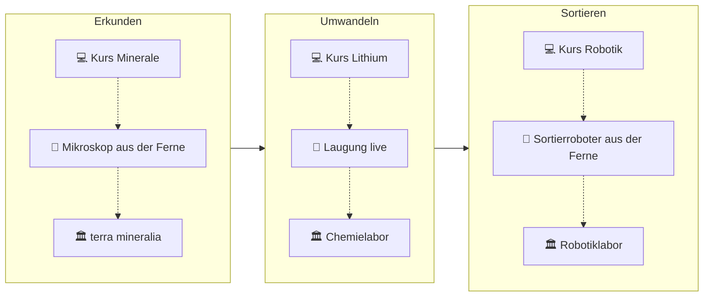

<!--
author:   MINT meets MONTAN – TU Bergakademie Freiberg
version:  1.0.0
language: de
narrator: Deutsch Female

comment:  Demo-Kurs „Finde Deinen Weg“ – ein Rundgang durch den Rohstoffkreislauf.
          Lithium ist der rote Faden: Erkunden, Umwandeln, Sortieren.

import: https://raw.githubusercontent.com/LiaTemplates/virtual-speaker/0.1.1/README.md
import: https://raw.githubusercontent.com/LiaTemplates/Wictionary/0.0.2/README.md
import: https://raw.githubusercontent.com/LiaTemplates/Wikimedia/0.0.2/README.md
import: https://raw.githubusercontent.com/LiaTemplates/mermaid_template/0.1.4/README.md
import: https://raw.githubusercontent.com/LiaTemplates/BeforeAndAfter/main/README.md
import: https://raw.githubusercontent.com/LiaTemplates/three.js/0.1.0/README.md
import: https://raw.githubusercontent.com/herbigm/ChemmacrosJS/main/README.md
import: https://raw.githubusercontent.com/LiaTemplates/JSXGraph/0.0.3/README.md
import: https://raw.githubusercontent.com/LiaTemplates/PeriodicTable/main/README.md
import: https://raw.githubusercontent.com/LiaTemplates/BlocklyCode/0.1.0/README.md
import: https://raw.githubusercontent.com/LiaTemplates/AVR8js/main/README.md
import: https://raw.githubusercontent.com/LiaTemplates/Chat-Simulation/main/README.md
import: https://raw.githubusercontent.com/LiaTemplates/Comunica/0.0.3/README.md

link:   https://cdn.jsdelivr.net/npm/pannellum@2.5.6/build/pannellum.css
script: https://cdn.jsdelivr.net/npm/pannellum@2.5.6/build/pannellum.js
link:   https://cdn.jsdelivr.net/npm/jsuites@4.17.7/dist/jsuites.css
link:   https://cdn.jsdelivr.net/npm/jspreadsheet-ce@4.13.4/dist/jspreadsheet.css
script: https://cdn.jsdelivr.net/npm/jsuites@4.17.7/dist/jsuites.js
script: https://cdn.jsdelivr.net/npm/jspreadsheet-ce@4.13.4/dist/index.js

@panorama
<div id="pano-@0" style="width:100%;height:420px;border-radius:8px;overflow:hidden"></div>
<script modify="false">
setTimeout(function () {
  const el = document.getElementById('pano-@0')
  if (el && !el.dataset.done && window.pannellum) {
    el.dataset.done = '1'
    window.pannellum.viewer(el, { type: 'equirectangular', panorama: '@1', autoLoad: true })
  }
}, 150)
""
</script>
@end

@tabelle
<div id="tab-@0"></div>
<script modify="false">
setTimeout(function () {
  const el = document.getElementById('tab-@0')
  if (el && !el.dataset.done && window.jspreadsheet) {
    el.dataset.done = '1'
    window.jspreadsheet(el, @1)
  }
}, 150)
""
</script>
@end

@style
details.partner {
  border-left: 6px solid #e0a800;
  background: rgba(224, 168, 0, 0.10);
  padding: 0.5rem 1rem;
  border-radius: 6px;
  margin-top: 1.5rem;
}
details.partner > summary { cursor: pointer; font-weight: bold; }
.idee { background: #eef3f8; color: #1b2d46; border-radius: 4px; padding: 0 6px; font-size: 0.85em; }
@end

@onload
window.VirtualSpeakerConfig = {
  default: { style: 'lorelei', seed: 'Mia', name: 'Mia' }
}

window.STATIONEN = [
  ['Erkunden', 'Geologinnen suchen, wo Rohstoffe stecken, und bestimmen Minerale.', '#erkunden:-ein-stein-voller-lithium', 'Etappe 2'],
  ['Gewinnen', 'Erz wird im Bergwerk oder Tagebau abgebaut – Lithium wird auch aus salzhaltigem Wasser gewonnen.', '', ''],
  ['Umwandeln', 'Aus Erz oder Altbatterie wird ein reiner Rohstoff, zum Beispiel Lithiumcarbonat.', '#umwandeln:-lithium-aus-erz-und-altbatterie', 'Etappe 3'],
  ['Nutzen', 'Lithium steckt in den Akkus von Handys, Laptops und E-Autos.', '', ''],
  ['Sortieren', 'Altgeräte und Akkus werden getrennt, damit die Wertstoffe zurückgewonnen werden können.', '#sortieren:-ein-roboter-lernt-trennen', 'Etappe 4'],
  ['Zurückführen', 'Zurückgewonnene Stoffe gehen wieder in die Produktion.', '', ''],
  ['Renaturieren', 'Abbauflächen werden wieder zu Landschaft, Wald oder See.', '', '']
]

window.kreisSVG = function (aktiv) {
  const S = window.STATIONEN, n = S.length, cx = 160, cy = 160, r1 = 72, r2 = 142
  const kern = ['Erkunden', 'Umwandeln', 'Sortieren']
  const pt = (r, a) => (cx + r * Math.cos(a)).toFixed(1) + ',' + (cy + r * Math.sin(a)).toFixed(1)
  let p = ''
  S.forEach(function (s, i) {
    const name = s[0]
    const a0 = -Math.PI / 2 + i * 2 * Math.PI / n + 0.03
    const a1 = a0 + 2 * Math.PI / n - 0.06
    const on = name === aktiv
    const fill = on ? '#e0a800' : (kern.includes(name) ? '#1f4e79' : '#b8c7d9')
    const tc = on ? '#000000' : (kern.includes(name) ? '#ffffff' : '#1b2d46')
    p += '<path d="M' + pt(r2, a0) + ' A' + r2 + ',' + r2 + ' 0 0 1 ' + pt(r2, a1) + ' L' + pt(r1, a1) + ' A' + r1 + ',' + r1 + ' 0 0 0 ' + pt(r1, a0) + ' Z" fill="' + fill + '" stroke="#ffffff" stroke-width="2"/>'
    const am = (a0 + a1) / 2
    p += '<text x="' + (cx + 107 * Math.cos(am)).toFixed(1) + '" y="' + (cy + 107 * Math.sin(am)).toFixed(1) + '" font-size="11" text-anchor="middle" dominant-baseline="middle" fill="' + tc + '" font-family="sans-serif">' + name + '</text>'
  })
  p += '<text x="160" y="154" font-size="14" text-anchor="middle" font-family="sans-serif" font-weight="bold" fill="#1b2d46">Rohstoff-</text>'
  p += '<text x="160" y="172" font-size="14" text-anchor="middle" font-family="sans-serif" font-weight="bold" fill="#1b2d46">kreislauf ↻</text>'
  const s = S.find(function (x) { return x[0] === aktiv }) || S[0]
  const ziel = s[2] ? ' → <a href="' + s[2] + '">weiter zu ' + s[3] + '</a>' : ' <span class="idee">in dieser Demo nur auf der Karte</span>'
  return '<svg viewBox="0 0 320 320" style="max-width:340px;width:100%;background:#ffffff;border-radius:50%" role="img" aria-label="Rohstoffkreislauf mit sieben Stationen, hervorgehoben: ' + s[0] + '">' + p + '</svg><p><b>' + s[0] + ':</b> ' + s[1] + ziel + '</p>'
}

window.kreisStrip = function (aktiv) {
  const on = String(aktiv).split('|')
  const teile = window.STATIONEN.map(function (s) {
    return on.includes(s[0])
      ? '<span style="background:#e0a800;color:#000000;padding:2px 8px;border-radius:12px;font-weight:bold">' + s[0] + '</span>'
      : '<span style="background:#dde5ef;color:#1b2d46;padding:2px 8px;border-radius:12px">' + s[0] + '</span>'
  })
  return 'HTML: <div style="display:flex;flex-wrap:wrap;gap:4px;align-items:center;font-size:0.85em" aria-label="Rohstoffkreislauf – hier sind wir: ' + on.join(', ') + '">📍 ' + teile.join(' → ') + ' ↻</div>'
}

window.BAND_DINGE = [
  { icon: '🥫', name: 'Alu-Dose', symbol: false, magnet: false, metall: true, soll: 'Alu' },
  { icon: '🔋', name: 'Akku', symbol: true, magnet: true, metall: true, soll: 'Akku-Box' },
  { icon: '🔩', name: 'Schraube', symbol: false, magnet: true, metall: true, soll: 'Schrott' },
  { icon: '🥤', name: 'Plastikbecher', symbol: false, magnet: false, metall: false, soll: 'Restmüll' },
  { icon: '🔋', name: 'Akku', symbol: true, magnet: true, metall: true, soll: 'Akku-Box' }
]
window.BAND_X = { 'Akku-Box': 95, 'Schrott': 245, 'Alu': 395, 'Restmüll': 545 }
window.bandRegeln = []

window.bandStart = async function () {
  const regeln = window.bandRegeln.slice()
  window.bandRegeln = []
  const lage = document.getElementById('band-dinge')
  const liste = document.getElementById('band-liste')
  if (lage) lage.innerHTML = ''
  const passt = {
    Batteriesymbol: function (d) { return d.symbol },
    Magnet: function (d) { return d.magnet },
    Metall: function (d) { return d.metall }
  }
  const inKiste = { 'Akku-Box': 0, 'Schrott': 0, 'Alu': 0, 'Restmüll': 0 }
  let fehler = 0
  const zeilen = []
  for (const d of window.BAND_DINGE) {
    let ziel = 'Restmüll'
    for (const r of regeln) {
      if (passt[r[0]] && passt[r[0]](d)) { ziel = r[1]; break }
    }
    const ok = ziel === d.soll
    if (!ok) fehler++
    zeilen.push(d.icon + ' ' + d.name + ' → ' + ziel + (ok ? ' ✅' : ' ❌ (gehört in: ' + d.soll + ')'))
    if (lage) {
      const t = document.createElementNS('http://www.w3.org/2000/svg', 'text')
      t.setAttribute('font-size', '26')
      t.textContent = d.icon
      lage.appendChild(t)
      const zx = window.BAND_X[ziel] - 40 + inKiste[ziel] * 26
      const zy = 215
      inKiste[ziel]++
      await new Promise(function (fertig) {
        const t0 = performance.now()
        function schritt (jetzt) {
          const q = Math.min(1, (jetzt - t0) / 450)
          const x = q < 0.6 ? 10 + (q / 0.6) * (window.BAND_X[ziel] - 10) : window.BAND_X[ziel] + ((q - 0.6) / 0.4) * (zx - window.BAND_X[ziel])
          const y = q < 0.6 ? 84 : 84 + ((q - 0.6) / 0.4) * (zy - 84)
          t.setAttribute('x', x.toFixed(1))
          t.setAttribute('y', y.toFixed(1))
          if (q < 1) requestAnimationFrame(schritt); else fertig()
        }
        requestAnimationFrame(schritt)
      })
    }
  }
  window.bandErgebnis = { fehler: fehler, zeilen: zeilen }
  if (liste) liste.innerHTML = zeilen.join('<br>') + '<br><b>' + (fehler === 0 ? 'Alles richtig sortiert! 🎉' : fehler + ' Teil(e) in der falschen Kiste.') + '</b>'
  console.log(zeilen.join('\n'))
  return fehler
}

if (window.LiaBlockly) {
  window.LiaBlockly.defineModule('band', {
    regel: function (sensor, kiste) { window.bandRegeln.push([sensor, kiste]) },
    start: function () { return window.bandStart() }
  })
  window.LiaBlockly.defineBlock({
    type: 'band_regel',
    category: { en: 'Sorting belt', de: 'Sortierband' },
    colour: 200,
    message: { en: 'if %1 detected, put into %2', de: 'wenn %1 erkannt, dann in %2' },
    args: [
      { type: 'field_dropdown', name: 'SENSOR', options: [
        [{ en: 'battery symbol (camera)', de: 'Batteriesymbol (Kamera)' }, '"Batteriesymbol"'],
        [{ en: 'magnet', de: 'Magnet' }, '"Magnet"'],
        [{ en: 'metal (detector)', de: 'Metall (Detektor)' }, '"Metall"']
      ] },
      { type: 'field_dropdown', name: 'KISTE', options: [
        [{ en: 'battery box', de: 'Akku-Box' }, '"Akku-Box"'],
        [{ en: 'scrap', de: 'Schrott' }, '"Schrott"'],
        [{ en: 'aluminium', de: 'Alu' }, '"Alu"'],
        [{ en: 'residual waste', de: 'Restmüll' }, '"Restmüll"']
      ] }
    ],
    call: 'band.regel(%1, %2)'
  })
  window.LiaBlockly.defineBlock({
    type: 'band_start',
    category: { en: 'Sorting belt', de: 'Sortierband' },
    colour: 120,
    message: { en: 'start the belt', de: 'starte das Band' },
    args: [],
    call: 'band.start()'
  })
}
@end

@wo: <script modify="false" style="display:block">window.kreisStrip("@0")</script>

@foerderband
<div style="max-width:640px">
<svg id="band-svg" viewBox="0 0 640 250" style="width:100%;background:#f4f1ea;border-radius:8px" role="img" aria-label="Förderband, darunter vier Kisten: Akku-Box, Schrott, Alu und Restmüll">
<text x="16" y="40" font-size="14" fill="#333333" font-family="sans-serif">Förderband →</text>
<rect x="10" y="90" width="580" height="16" rx="8" fill="#555555"/>
<g font-family="sans-serif" font-size="13" fill="#1b2d46">
<rect x="40" y="150" width="110" height="90" rx="6" fill="#ffe08a" stroke="#b38600"/><text x="95" y="168" text-anchor="middle">Akku-Box</text>
<rect x="190" y="150" width="110" height="90" rx="6" fill="#cfd8dc" stroke="#78909c"/><text x="245" y="168" text-anchor="middle">Schrott</text>
<rect x="340" y="150" width="110" height="90" rx="6" fill="#e3f2fd" stroke="#64b5f6"/><text x="395" y="168" text-anchor="middle">Alu</text>
<rect x="490" y="150" width="110" height="90" rx="6" fill="#eeeeee" stroke="#9e9e9e"/><text x="545" y="168" text-anchor="middle">Restmüll</text>
</g>
<g id="band-dinge"></g>
</svg>
<div id="band-liste" style="font-size:0.9em;margin-top:0.5rem"></div>
</div>
@end
-->

# Finde Deinen Weg – Ein Rundgang durch den Rohstoffkreislauf

    --{{0}}--
Hey, ich bin Mia. Ehrlich gesagt hab ich mich früher nie gefragt, wo das Lithium in meinem Handy-Akku herkommt. Heute weiß ich: Bevor es in deinem Akku landet, steckte es in einem Stein – und wenn der Akku kaputt ist, kann es zurück in den Kreislauf. Genau diesen Weg gehen wir jetzt zusammen. Du musst nichts vorher wissen, probier einfach aus.

Woher kommt das Lithium in deinem Handy-Akku – und was passiert damit, wenn der Akku kaputt ist? In fünf kurzen Etappen folgst du dem Lithium durch den Rohstoffkreislauf: Du bestimmst ein Mineral, holst Lithium in einem simulierten Laborversuch aus Erz und Altbatterie und bringst einem Roboter bei, Wertstoffe zu sortieren.

Jede Etappe dauert etwa 10 Minuten. Blättere einfach weiter – oder spring über die Landkarte direkt zu der Station, die dich am meisten interessiert.

> 👋 **Mia** begleitet dich durch den Rundgang. Mia ist eine ausgedachte Figur. Im Projekt begleiten dich echte Studentinnen.
>
> 🔊 Am schönsten ist der Rundgang mit Ton im Folienmodus: Dann spricht Mia mit dir.

<details class="partner">
<summary>🤝 Für die Projektpartner: Was diese Demo zeigt</summary>

Dieser Kurs ist eine **Demo für das Vorhaben „MINT meets MONTAN“**. Er bildet ab, wie ein digitales Angebot im Netz über dem Rohstoffkreislauf aussehen kann (Ideenpapier, Abschnitt 2 und 5):

* Lithium als **roter Faden** durch die drei Kernstationen Erkunden, Umwandeln und Sortieren
* jede Etappe beginnt und endet mit der Frage: **Wo im Kreislauf stehen wir?**
* jede Etappe verweist auf **hybride und reale Angebote** und auf **Studiengänge**
* „Sinn statt Technik“: Jede Etappe startet mit einer Frage aus dem Alltag

Pro Etappe gibt es einen **Kern** (etwa 10 Minuten) und **Extras für Neugierige**. In diesen Kästen steht jeweils, welcher Teil des Antrags gemeint ist und was LiaScript dort zeigt. Messwerte, Remote-Experimente und Personen sind **Beispiele oder Ideen** und als solche gekennzeichnet.

</details>


## Die Landkarte: Woher kommt dein Akku?

    --{{0}}--
Hast du schon mal überlegt, was alles in deinem Handy steckt? Im Akku zum Beispiel Lithium. Und das hat schon einen langen Weg hinter sich, bevor es bei dir ankommt.

@wo(Nutzen)

**Woher kommt das Lithium in deinem Akku – und wohin geht es, wenn der Akku kaputt ist?**

Ein Akku ist nicht einfach „da“. Bevor er in deinem Handy steckt, haben viele Menschen an ihm gearbeitet: Sie haben das Lithium gefunden, aus der Erde geholt, gereinigt und verarbeitet. Und wenn der Akku alt ist, kann das Lithium wieder zurückgewonnen werden.

Dieser Weg ist ein **Kreislauf**. Auf den nächsten Seiten siehst du ihn als Karte.


### Der Rohstoffkreislauf

    --{{0}}--
Hier siehst du den ganzen Kreislauf. Wähl eine Station aus und lies, was dort passiert. Die drei dunkelblauen Stationen besuchen wir gleich gemeinsam.

Der Kreislauf hat sieben Stationen. **Wähle eine Station aus:**

Station: <script input="select" options="Erkunden|Gewinnen|Umwandeln|Nutzen|Sortieren|Zurückführen|Renaturieren" value="Erkunden" aria-label="Station im Rohstoffkreislauf wählen" input-always-active output="station" default="Erkunden" modify="false">"@input"</script>

<script style="display:block" modify="false">
"HTML: " + window.kreisSVG("@input(`station`)")
</script>

Die drei **dunkelblauen** Stationen besuchen wir in den Etappen 2 bis 4. Eine feste Reihenfolge gibt es nicht – du kannst an jeder Stelle einsteigen.


### Ein Blick in den Stollen

    --{{0}}--
Stell dir vor, du stehst in einem Stollen. Hinter jedem Schild beginnt eine andere Station. Zieh mit der Maus oder dem Finger, um dich umzusehen.

Stell dir vor, der Kreislauf wäre ein Bergwerk: Hinter jedem Schild beginnt ein Gang zu einer Station. **Zieh mit der Maus oder dem Finger, um dich einmal ganz umzusehen.**

@[panorama(stollen)](assets/images/stollen-360.png)

Ein gezeichneter Stollen, kein Foto. Echte Bergwerke kannst du im Projekt auch besuchen, zum Beispiel das Lehrbergwerk in Freiberg. <span class="idee">Idee</span>


### Ordne zu

    --{{0}}--
Jetzt bist du dran. Was passiert an welcher Station? Zieh die Wörter in die richtige Zeile.

An welcher Station passiert das? **Zieh jede Station in die passende Zeile.**

<!-- data-randomize data-show-partial-solution -->
| Was passiert?                                     | Station          |
|---------------------------------------------------|------------------|
| Ein Bagger holt Gestein aus der Grube             | [->[Gewinnen]]   |
| Im Labor wird aus Gesteinspulver ein weißes Salz  | [->[Umwandeln]]  |
| Du lädst dein Handy über Nacht auf                | [->[Nutzen]]     |
| Eine Anlage trennt Akkus von Dosen und Schrauben  | [->[Sortieren]]  |


### Was interessiert dich?

    --{{0}}--
Und jetzt du: Welche Station klingt für dich am spannendsten? Hier gibt es kein Richtig oder Falsch.

Welche Station interessiert dich am meisten? Hier gibt es kein Richtig oder Falsch.

<!-- data-updates-allowed -->
- [(erkunden)] Erkunden – Steine bestimmen und verstehen
- [(umwandeln)] Umwandeln – im Labor aus Erz einen Rohstoff machen
- [(sortieren)] Sortieren – Robotern beibringen, Müll zu trennen
- [(weiss-nicht)] Weiß ich noch nicht – ich schau mir alles an


### Extra: Vom Tagebau zum See

<span class="idee">Für Neugierige</span>

Die letzte Station im Kreislauf heißt **Renaturieren**: Wo früher abgebaut wurde, entsteht wieder Landschaft. Zieh den Regler hin und her.

@beforeAndAfter(https://commons.wikimedia.org/wiki/Special:FilePath/Tagebau_Cottbus-Nord_Luftbild_2007.jpg,https://commons.wikimedia.org/wiki/Special:FilePath/Cottbuser_Ostsee_in_july_2019_08.jpg?width=800)

**Links:** der Braunkohle-Tagebau Cottbus-Nord in der Lausitz, 2007 aus der Luft. **Rechts:** dieselbe Gegend im Juli 2019, vom Boden aus. Der Abbau ist vorbei, Pflanzen wachsen – hier entsteht der Cottbuser Ostsee. Die beiden Fotos sind aus verschiedenen Blickwinkeln aufgenommen.


### Wie geht es weiter?

    --{{0}}--
Super, jetzt kennst du die Karte. Als Nächstes gehen wir zur ersten Station: Erkunden. Dort schauen wir uns an, in welchen Steinen Lithium steckt.

@wo(Erkunden)

Du kennst jetzt die Karte. Unser Rundgang beginnt ganz am Anfang des Kreislaufs: **beim Erkunden**. Dort schauen wir, in welchen Steinen Lithium steckt.

→ [Weiter zu Etappe 2: Erkunden](#erkunden:-ein-stein-voller-lithium)

**So gibt es im Projekt weiter:**

* 💻 digital: dieser Kurs und weitere Kurse zu jeder Station
* 🔭 hybrid: Experimente aus der Ferne steuern <span class="idee">Idee</span>
* 🏛️ real: Lernorte in Freiberg und bei Firmen der Region besuchen <span class="idee">Idee</span>

<details class="partner">
<summary>🤝 Für die Projektpartner</summary>

**Bezug zum Antrag:** Leitidee „Netz von Angeboten über dem Rohstoffkreislauf“ (Abschnitt 2, Abb. 1). Die Landkarte ist der Einstieg, von dem aus man an jeder Stelle einsteigen kann.

**Was LiaScript hier zeigt:**

* ein **Skript**, das den Kreislauf als SVG zeichnet und die gewählte Station hervorhebt
* ein **360°-Rundblick** (Bibliothek Pannellum, direkt eingebunden) – hier mit einem gezeichneten Stollen; im Projekt wären echte Panoramen von Lernorten möglich
* **Drag & Drop**, eine **Umfrage** und ein **Vorher/Nachher-Regler** (Vorlage BeforeAndAfter)
* **Mia als sprechender Avatar** (Vorlage virtual-speaker) – sichtbar im Folienmodus mit Ton

</details>


## Erkunden: Ein Stein voller Lithium

    --{{0}}--
Willkommen bei der ersten Station: Erkunden. Wusstest du, dass Lithium in ganz bestimmten Steinen steckt? Lass uns herausfinden, wie man sie erkennt.

@wo(Erkunden)

**Lithium in einem Stein? Wie soll man das sehen?**

Lithium wird zum Teil aus Gestein gewonnen. Es steckt dort aber nicht als glänzendes Metall, sondern versteckt in bestimmten @wik(Mineral, de)en. Wer Lithium finden will, muss diese Minerale also erkennen können.

Genau das machen Geologinnen und Mineralogen: Sie **erkunden**, was in einem Stein steckt.


### Woran erkennt man ein Mineral?

    --{{0}}--
Minerale haben Merkmale, an denen man sie erkennt, fast wie ein Steckbrief. Vier davon schauen wir uns an.

Jedes Mineral hat einen **Steckbrief**. Vier Merkmale helfen dir:

| Merkmal          | Was du prüfst                                                |
|------------------|--------------------------------------------------------------|
| **Farbe**        | Welche Farbe hat der Stein?                                  |
| **Glanz**        | Glänzt er wie Glas, wie Perlmutt oder gar nicht?             |
| **Spaltbarkeit** | Bricht er in dünne Blättchen, in Stücke oder unregelmäßig?   |
| **Härte**        | Kannst du ihn mit dem Fingernagel oder einem Messer ritzen?  |

Die Härte misst man mit der **Mohs-Skala** von 1 (sehr weich) bis 10 (sehr hart):

<!-- data-type="bar" data-show data-title="Härte nach Mohs (typische, gerundete Werte)" data-ylabel="Mohs-Härte" aria-label="Balkendiagramm der Mohs-Härte: Fingernagel 2,5, Lepidolith 3, Zinnwaldit 3, Taschenmesser 5,5, Spodumen 7" -->
| Vergleich     | Mohs-Härte |
|---------------|-----------:|
| Fingernagel   | 2.5        |
| Lepidolith    | 3          |
| Zinnwaldit    | 3          |
| Taschenmesser | 5.5        |
| Spodumen      | 7          |


### Drei Lithium-Minerale

    --{{0}}--
Hier sind drei Minerale, in denen Lithium steckt. Schau dir Farbe und Form genau an. Gleich darfst du selbst bestimmen.

**Lepidolith** – rosa bis grauviolett, perlmuttartig glänzend. Er gehört zu den @wik(Glimmer, de)n: Er lässt sich in hauchdünne Blättchen spalten und ist weich (Härte 2,5 bis 3).

@Wikimedia.embed(File:Lepidolite_from_Brazil.jpg)

**Zinnwaldit** – graubraun bis grünlich, ebenfalls ein Glimmer aus glänzenden Blättchen, oft fächer- oder rosettenförmig gewachsen (Härte 2,5 bis 4). Sein Name kommt vom Ort Zinnwald im Erzgebirge, wo er zuerst gefunden wurde.

@Wikimedia.embed(File:Zinnwaldite2.jpg)

**Spodumen** – meist hell: farblos, weißlich, gelblich oder grünlich, selten rosa. Seine Kristalle sind länglich, mit Streifen in Längsrichtung. Er ist deutlich härter (6,5 bis 7): Ein Taschenmesser ritzt ihn nicht.

@Wikimedia.embed(https://commons.wikimedia.org/wiki/File:Spodumene_%28GeoDIL_number_-_400%29.jpg)


### Bestimme selbst

    --{{0}}--
Jetzt bist du die Mineralogin. Schau dir die beiden Fotos an. Welches Mineral ist es jeweils?

<div>

**Foto A:** Welches Mineral ist das?

<!-- style="max-height: 200px;" -->

</div>

<!-- data-hint-button="1" data-max-trials="3" data-solution-button="false" -->
- [( )] Lepidolith
- [(X)] Spodumen
- [( )] Zinnwaldit
- [[?]] {|>}{Achte auf die Form: Sind es dünne Blättchen – oder ein langer Kristall mit Streifen?}

<div>

**Foto B:** Und welches Mineral ist das?

<!-- style="max-height: 180px;" -->

</div>

<!-- data-hint-button="1" data-max-trials="3" data-solution-button="false" -->
- [( )] Zinnwaldit
- [( )] Spodumen
- [(X)] Lepidolith
- [[?]] {|>}{Achte auf Farbe und Form: Welches Mineral ist rosa bis violett und bildet keinen langen, gestreiften Kristall?}


### Unter dem Mikroskop

    --{{0}}--
Unter dem Mikroskop sehen Minerale noch mal ganz anders aus. Mit polarisiertem Licht leuchten Glimmer in bunten Farben.

Mineralogen schauen sich Gestein auch unter dem **Polarisationsmikroskop** an. Dafür wird ein Stein so dünn geschliffen, dass Licht hindurchscheint. In polarisiertem Licht leuchten viele Minerale in kräftigen Farben – so lassen sie sich unterscheiden.


Die bunten Leisten sind **Muskovit**, ein Glimmer wie Lepidolith und Zinnwaldit. Im Projekt soll man so ein Mikroskop auch aus der Ferne steuern können. <span class="idee">Idee</span>


### Welches Merkmal hat dir geholfen?

    --{{0}}--
Kurz nachdenken: Woran hast du die Minerale erkannt? Schreib es in ein, zwei Sätzen auf.

Woran hast du die Minerale auf Foto A und Foto B erkannt? Schreib ein, zwei Sätze.

[[___ ___ ___]]


### Extra: Ein Modellkristall zum Drehen

<span class="idee">Für Neugierige</span>

Links ein Stapel aus Glimmer-Blättchen, rechts ein Spodumen-Kristall – beides **vereinfachte Modelle**, keine echten Scans. Dreh das Modell mit der Maus und klick auf die Teile.

```js @THREE.scene
const lila = new THREE.MeshStandardMaterial({ color: '#9b7bc4', metalness: 0.2, roughness: 0.35 })
for (let i = 0; i < 8; i++) {
  add(new THREE.Mesh(new THREE.CylinderGeometry(1.2, 1.2, 0.08, 6), lila),
      { x: -2, y: 0.1 + i * 0.12, info: 'Glimmer wie Lepidolith: viele dünne Blättchen übereinander' })
}
const blatt = new THREE.Mesh(new THREE.CylinderGeometry(1.2, 1.2, 0.08, 6), lila)
blatt.rotation.z = 0.35
add(blatt, { x: -1.6, y: 1.6, info: 'Ein abgespaltenes Blättchen – Glimmer lässt sich sehr leicht spalten' })
const hell = new THREE.MeshStandardMaterial({ color: '#efe6cf', roughness: 0.5 })
add(new THREE.Mesh(new THREE.BoxGeometry(0.9, 0.9, 3.2), hell),
    { x: 2, y: 0.45, info: 'Spodumen: ein länglicher, harter Kristall mit Streifen in Längsrichtung' })
```


### Wie geht es weiter?

    --{{0}}--
Du hast heute wie eine Mineralogin gearbeitet. Wenn dir das Spaß gemacht hat, schau dir den Studiengang Geologie und Mineralogie an.

@wo(Gewinnen)

Wenn man weiß, wo Lithium-Minerale stecken, geht es weiter: Das @wik(Erz, de) wird **gewonnen**, also abgebaut. Danach muss das Lithium aus dem Stein heraus – das ist die nächste Etappe: **Umwandeln**.

→ [Weiter zu Etappe 3: Umwandeln](#umwandeln:-lithium-aus-erz-und-altbatterie)

**Hat dir das Erkunden gefallen?**

* 🎓 Studiengang: **Geologie/Mineralogie**
* 🏛️ Lernort: die Mineraliensammlung **terra mineralia** in Freiberg
* 🔭 Mikroskop aus der Ferne steuern <span class="idee">Idee</span>

<details class="partner">
<summary>🤝 Für die Projektpartner</summary>

**Bezug zum Antrag:** Station *Erkunden* – „Woraus besteht die Welt?“ (Abschnitt 5, Mineralogie), mit Objektzwilling und Mikroskopie aus der Ferne.

**Was LiaScript hier zeigt:**

* frei lizenzierte **Fotos von Wikimedia Commons** mit Bildnachweis (Kapitel „Bildnachweise“) und anklickbare Fachwörter mit Bedeutung aus dem Wiktionary
* ein **Diagramm**, das direkt aus einer Tabelle entsteht
* ein **3D-Modell zum Drehen** (Vorlage three.js) als Vorstufe eines Objektzwillings – mit echten Scans aus der Sammlung wäre das ein echter Zwilling
* Quiz mit **Tipp nach dem ersten Fehlversuch** und eine **Freitext-Reflexion**

Mineral-Merkmale und Härtewerte sind mit Wikipedia belegt (Seite „Quellen“); eine Durchsicht durch die Mineralogie bleibt sinnvoll.

</details>


## Umwandeln: Lithium aus Erz und Altbatterie

    --{{0}}--
Willkommen im Labor! Jetzt holen wir das Lithium aus dem Stein heraus. Und aus alten Akkus übrigens auch.

@wo(Umwandeln)

**Wie wird aus einem Stein – oder aus einem alten Akku – wieder ein Rohstoff?**

Im Mineral ist Lithium fest im Kristall eingebaut. Um daraus einen Akku zu bauen, braucht man es aber **rein**. Und: Auch in alten Akkus steckt noch Lithium. Statt es wegzuwerfen, kann man es zurückgewinnen.

In beiden Fällen hilft ein Verfahren, das du gleich ausprobierst: die **Laugung**.


### Lithium im Periodensystem

    --{{0}}--
Lithium ist ein chemisches Element. Such es im Periodensystem. Es hat die Ordnungszahl drei.

Lithium (Zeichen **Li**, Ordnungszahl 3) ist ein chemisches Element. Es ist das leichteste aller Metalle. **Such Lithium im Periodensystem** – auf einem großen Bildschirm steht es in der ersten Spalte, zweite Zeile.

@PeriodicTable.withStyle("width: 100%; height: 520px;")

Zu welcher Gruppe von Elementen gehört Lithium?

<!-- data-hint-button="1" data-max-trials="3" data-solution-button="false" -->
- [( )] Edelgase
- [(X)] Alkalimetalle
- [( )] Halogene
- [( )] Erdalkalimetalle
- [[?]] {|>}{Schau in die erste Spalte ganz links.}


### Laugung – wie Tee ziehen lassen

    --{{0}}--
Laugung klingt kompliziert, ist aber ein bisschen wie Teekochen. Das heiße Wasser holt den Geschmack aus den Blättern. Bei der Laugung holt eine Flüssigkeit das Lithium aus dem Gestein.

Kennst du das? Du hängst einen Teebeutel in heißes Wasser, und der Geschmack löst sich aus den Blättern. Bei der **Laugung** ist es ähnlich: Eine Flüssigkeit löst das Lithium aus dem zerkleinerten Material.

**Vereinfacht läuft es so:**

1. Das Erz wird zerkleinert und geröstet, also stark erhitzt.
2. Es wird mit @wik(Säure, de) aufgeschlossen, meist mit Schwefelsäure. Dabei geht das Lithium als Salz in Lösung – das ist die Laugung.
3. Gibt man Soda (Natriumcarbonat) dazu, fällt **Lithiumcarbonat** als weißer Feststoff aus:

@reaction(2 Li^+ + Na2CO3 -> Li2CO3 + 2 Na^+)

Aus alten Akkus wird nach dem Schreddern eine **Schwarzmasse**. Auch sie wird mit Säuren behandelt, und das Lithium wird als Lithiumcarbonat zurückgewonnen.

**Vorsicht im Labor:** Schwefelsäure ist ätzend. Im echten Labor arbeitest du deshalb mit Schutzbrille und Handschuhen.

@ghspic(acid)


### Simulation: Mach es wärmer!

    --{{0}}--
Jetzt darfst du experimentieren. Mit dem Regler stellst du die Temperatur ein. Beobachte, wie schnell sich das Lithium löst.

Wie schnell löst sich das Lithium? **Verschieb den Regler T für die Temperatur in °C** und beobachte die Kurve. Sie zeigt, wie viel Prozent des Lithiums nach einer bestimmten Zeit gelöst sind.

```javascript @JSX.Graph.withParams(`boundingbox="[-18, 115, 130, -28]" axis="true" showNavigation="false"`)
var T = board.create('slider', [[15, 104], [75, 104], [20, 20, 90]], { name: 'T (°C)', snapWidth: 1, precision: 0, digits: 0 });
var anteil = function (t) {
  var k = 0.01 * Math.pow(2, (T.Value() - 20) / 10);
  return 95 * (1 - Math.exp(-k * t));
};
board.create('functiongraph', [anteil, 0, 120], { strokeWidth: 3, strokeColor: '#1f4e79' });
board.create('text', [62, 18, function () { return 'nach 60 min gelöst: ' + anteil(60).toFixed(0) + ' %'; }], { fontSize: 14 });
board.create('text', [95, -20, 'Zeit in min']);
board.create('text', [-15, 110, '% gelöst']);
```

<span class="idee">Modell mit ausgedachten Zahlen</span> Die Kurve folgt einer Faustregel aus der Chemie, der RGT-Regel: **10 °C wärmer – etwa doppelt bis viermal so schnell.** Unser Modell rechnet mit doppelt. Echte Messwerte liefert im Projekt der Versuch „Laugung live“.


### Was zeigt die Kurve?

    --{{0}}--
Was hast du beobachtet? Probier es ruhig noch einmal mit dem Regler aus, bevor du antwortest.

Du stellst die Temperatur von 30 °C auf 40 °C. Was zeigt das Modell?

<!-- data-hint-button="1" data-max-trials="3" data-solution-button="false" -->
- [( )] Die Kurve steigt etwa halb so schnell an
- [( )] Die Kurve steigt gleich schnell an
- [(X)] Die Kurve steigt etwa doppelt so schnell an
- [[?]] {|>}{Geh zurück zur Seite „Simulation: Mach es wärmer!“ und vergleich den Wert „nach 60 min gelöst“ bei 30 °C und bei 40 °C.}

Warum wird die Kurve oben flach, statt immer weiter zu steigen?

<!-- data-hint-button="1" data-max-trials="3" data-solution-button="false" -->
- [( )] Die Flüssigkeit wird mit der Zeit immer kälter
- [(X)] Die Menge an Lithium im Material ist fast erschöpft
- [( )] Die Säure verwandelt das Lithium in ein Gas
- [[?]] {|>}{Denk an den Tee: Irgendwann ist kein Geschmack mehr in den Blättern.}


### Mia fragt

    --{{0}}--
Ich hab eine Frage an dich: Warum lohnt es sich eigentlich, alte Akkus zu recyceln? Schreib mir deine Meinung.

Mia fragt dich: **Warum lohnt es sich, Lithium aus alten Akkus zurückzugewinnen?** Schreib ein, zwei Sätze.

[[___ ___ ___]]


### Extra: Messwerte selbst auswerten

<span class="idee">Für Neugierige</span>

So könnten Messwerte einer Laugung aussehen <span class="idee">Beispieldaten</span>. Wären alle 1000 mg Lithium pro Liter gelöst, wäre die Ausbeute 100 %. Die dritte Spalte rechnet das mit einer Formel aus – ändere einen Messwert und schau, was passiert.

```json @tabelle(laugung)
{
  "data": [
    [0, 0, "=B1/10"],
    [15, 180, "=B2/10"],
    [30, 330, "=B3/10"],
    [60, 550, "=B4/10"],
    [120, 800, "=B5/10"]
  ],
  "columns": [
    { "title": "Zeit (min)", "width": 90 },
    { "title": "Lithium (mg/L)", "width": 110 },
    { "title": "Ausbeute (%)", "width": 100 }
  ]
}
```

Wie viel Prozent sind nach 60 Minuten gelöst?

[[55]]


### Extra: Der Recycling-Rechner

<span class="idee">Für Neugierige</span>

Wie viel Lithium könnte aus alten Akkus kommen? **Stell mit dem Regler ein, wie viel Prozent der alten Akkus gesammelt werden.** <span class="idee">Beispielrechnung mit ausgedachten Zahlen</span>

Gesammelt: <script input="range" min="0" max="100" value="30" step="5" aria-label="Anteil der alten Akkus, die gesammelt werden, in Prozent" input-always-active output="quote" default="30" modify="false">@input + " %"</script>

<script style="display:block" modify="false">
const q = parseInt("@input(`quote`)") / 100
const bedarf = 100, alt = 40, ausbeute = 0.9
const rec = Math.round(alt * q * ausbeute)
const neu = bedarf - rec
const opt = {
  title: { text: 'Beispiel: 100 t Lithium werden gebraucht' },
  tooltip: {},
  legend: { bottom: 0 },
  xAxis: { type: 'category', data: ['Bedarf'] },
  yAxis: { type: 'value', max: 100, name: 'Tonnen' },
  series: [
    { name: 'aus Recycling', type: 'bar', stack: 'a', data: [rec], itemStyle: { color: '#2e7d32' } },
    { name: 'neu abgebaut', type: 'bar', stack: 'a', data: [neu], itemStyle: { color: '#8d6e63' } }
  ]
}
"HTML: <p>Gesammelt: <b>" + Math.round(q * 100) + " %</b> der alten Akkus → <b>" + rec + " t</b> aus Recycling, <b>" + neu + " t</b> müssen neu abgebaut werden.</p><lia-chart style='height:300px' option='" + JSON.stringify(opt) + "'></lia-chart>"
</script>

Annahmen der Beispielrechnung: In den alten Akkus stecken 40 t Lithium, und 90 % davon lassen sich zurückgewinnen. In diesem Beispiel reicht selbst das Sammeln aller alten Akkus nicht: In ihnen steckt weniger Lithium, als neu gebraucht wird.


### Wie geht es weiter?

    --{{0}}--
Du hast heute im Labor gearbeitet. Wenn dir Chemie Spaß gemacht hat, sind die Studiengänge Chemie und Angewandte Naturwissenschaft vielleicht was für dich.

@wo(Nutzen)

Das reine Lithium wird zu Akkus verarbeitet und landet zum Beispiel in deinem Handy – die Station **Nutzen**. Irgendwann ist der Akku alt. Dann muss er aus dem Müll heraus: Das ist die nächste Etappe, **Sortieren**.

→ [Weiter zu Etappe 4: Sortieren](#sortieren:-ein-roboter-lernt-trennen)

**Hat dir das Umwandeln gefallen?**

* 🎓 Studiengänge: **Chemie** und **Angewandte Naturwissenschaft**
* 🏛️ Lernort: das **Chemielabor** der TU Bergakademie Freiberg
* 🔭 Laugung live: einen echten Versuch aus der Ferne verfolgen, mit echten Messwerten <span class="idee">Idee</span>

<details class="partner">
<summary>🤝 Für die Projektpartner</summary>

**Bezug zum Antrag:** Station *Umwandeln* – „Wie wird aus Erz oder Altbatterie ein Wertstoff?“ (Abschnitt 5, Technische Chemie), mit dem Remote-Experiment „Laugung live mit Messwerten“.

**Was LiaScript hier zeigt:**

* eine **Simulation mit Schieberegler** (Vorlage JSXGraph) – im Projekt könnte sie echte Messwerte aus dem Remote-Versuch nutzen
* **Reaktionsgleichung und Gefahrensymbol** (Vorlage ChemmacrosJS) und ein **Periodensystem** (Vorlage PeriodicTable)
* eine **Tabelle mit Formeln** (Bibliothek jspreadsheet, direkt eingebunden) und ein **Rechner mit Diagramm**, den LiaScript ohne Vorlage kann
* eine Frage von Mia mit **freier Antwort**

Verfahrensschritte, Reaktionsgleichung und Faustregel sind mit Wikipedia belegt (Seite „Quellen“); eine Durchsicht durch die Technische Chemie bleibt sinnvoll. Die Messwerte und der Recycling-Rechner sind ausgedachte Beispiele.

</details>


## Sortieren: Ein Roboter lernt trennen

    --{{0}}--
Willkommen an der Sortieranlage! Hier landet alles, was Menschen wegwerfen. Und mittendrin: alte Akkus. Die müssen da schnell raus.

@wo(Sortieren)

**Warum gehören alte Akkus nicht in den Müll?**

Akkus können Feuer fangen, wenn sie beschädigt werden. Landen sie im Restmüll, kann das in Recyclinganlagen gefährlich werden: In der Schweiz wurden 2023 zwölf solche Brände in Recyclingbetrieben gezählt. Außerdem steckt in Akkus wertvolles Lithium. Deshalb müssen sie **früh aussortiert** werden.

In modernen Sortieranlagen erkennen Sensoren wie Kameras und Metalldetektoren die Teile, und eine Maschine sortiert sie aus. Unser Roboter ist ein vereinfachtes Beispiel. Aber woher weiß er, was er vor sich hat?


### Wie ein Roboter „sieht“

    --{{0}}--
Ein Roboter hat keine Augen wie wir. Er hat Sensoren. Jeder Sensor beantwortet eine einfache Frage mit Ja oder Nein.

Ein Roboter hat keine Augen wie wir, sondern @wik(Sensor, de)en. Jeder Sensor beantwortet eine einfache Frage:

* 📷 **Kamera:** Ist ein Batteriesymbol zu sehen?
* 🧲 **Magnet:** Wird das Teil angezogen?
* 📡 **Metalldetektor:** Ist es aus Metall?

So „sieht“ der Roboter die Teile auf unserem Band:

<!-- data-type="none" -->
| Teil             | 📷 Batteriesymbol | 🧲 Magnet | 📡 Metall | gehört in  |
|------------------|:-----------------:|:---------:|:---------:|------------|
| 🥫 Alu-Dose      | nein              | nein      | ja        | Alu        |
| 🔋 Akku          | ja                | ja        | ja        | Akku-Box   |
| 🔩 Schraube      | nein              | ja        | ja        | Schrott    |
| 🥤 Plastikbecher | nein              | nein      | nein      | Restmüll   |

In unserem Beispiel steckt der Akku in einem Gehäuse aus Stahl – deshalb zieht der Magnet ihn an, genau wie die Schraube.


### Programmiere die Sortierweiche

    --{{0}}--
Jetzt programmierst du den Roboter. Die Regeln werden von oben nach unten geprüft. Die erste Regel, die passt, entscheidet. Starte das Band einmal und schau, was passiert.

Der Roboter prüft seine Regeln **von oben nach unten**. Die erste Regel, die passt, bestimmt die Kiste. Was zu keiner Regel passt, kommt in den Restmüll.

1. Klick unter dem Code auf den runden Knopf `</>` (Ausführen) und schau, wo die Teile landen.
2. Die Akkus landen im Schrott – gefährlich! **Ergänze eine Regel**, damit sie in der Akku-Box landen.
3. Führ das Programm noch einmal aus, bis alles richtig sortiert ist. Du kannst die Blöcke ziehen oder den Code darüber ändern.

@foerderband

```js
band.regel("Magnet", "Schrott");
band.regel("Metall", "Alu");
band.start();
```
```js -Check
await run()
expect(window.bandErgebnis && window.bandErgebnis.fehler === 0, "Noch landet etwas in der falschen Kiste. Tipp: Die Reihenfolge der Regeln ist wichtig.")
```
@Blockly.js.check(`blocks=band_regel|band_start turtle=no`)


### Was ging schief?

    --{{0}}--
Denk noch mal an den ersten Versuch zurück, bevor du die Regel ergänzt hast.

Mit den ursprünglichen zwei Regeln: Welches Teil landete in der falschen Kiste?

<!-- data-hint-button="1" data-max-trials="3" data-solution-button="false" -->
- [( )] die Schraube
- [( )] die Alu-Dose
- [( )] der Plastikbecher
- [(X)] der Akku
- [[?]] {|>}{Schau in die Tabelle auf der Seite „Wie ein Roboter ‚sieht‘“: Welches Teil wird vom Magneten angezogen, gehört aber nicht in den Schrott?}

Und warum muss die neue Regel **ganz oben** stehen?

[[___ ___]]


### Extra: Reicht ein Sensor?

<span class="idee">Für Neugierige</span>

Ein echter Magnetsensor sagt nicht nur „ja“ oder „nein“, sondern misst, **wie stark** ein Teil angezogen wird. Kann der Roboter Akkus und Eisenteile allein am Magnetwert unterscheiden? **Verschieb die Schwelle:** Alles mit einem höheren Wert landet im Schrott. <span class="idee">Beispielwerte</span>

Schwelle: <script input="range" min="0" max="100" value="50" step="1" aria-label="Schwelle für den Magnetwert" input-always-active output="schwelle" default="50" modify="false">@input</script>

<script style="display:block" modify="false">
const s = parseInt("@input(`schwelle`)")
const teile = [['Schraube', 92, 'eisen'], ['Nagel', 85, 'eisen'], ['Akku 1', 82, 'akku'], ['Akku 2', 71, 'akku'], ['Eisendose', 68, 'eisen'], ['Alu-Dose', 6, 'rest'], ['Becher', 1, 'rest']]
let akkuImSchrott = 0, eisenVerpasst = 0
const punkte = teile.map(function (t, i) {
  const schrott = t[1] >= s
  if (schrott && t[2] === 'akku') akkuImSchrott++
  if (!schrott && t[2] === 'eisen') eisenVerpasst++
  const farbe = t[2] === 'akku' ? (schrott ? '#d32f2f' : '#2e7d32') : (t[2] === 'eisen' ? (schrott ? '#2e7d32' : '#ef6c00') : '#9e9e9e')
  return { value: [t[1], i], name: t[0], itemStyle: { color: farbe } }
})
const opt = {
  tooltip: {},
  grid: { left: 85, right: 30 },
  xAxis: { type: 'value', min: 0, max: 100, name: 'Magnetwert', nameLocation: 'middle', nameGap: 28 },
  yAxis: { type: 'category', data: teile.map(function (t) { return t[0] }) },
  series: [{ type: 'scatter', symbolSize: 18, data: punkte, markLine: { symbol: 'none', data: [{ xAxis: s }], lineStyle: { color: '#1f4e79', width: 2 } } }]
}
"HTML: <p>Schwelle " + s + ": <b>" + akkuImSchrott + "</b> Akku(s) im Schrott 🔥 · <b>" + eisenVerpasst + "</b> Eisenteil(e) verpasst</p><lia-chart style='height:320px' option='" + JSON.stringify(opt) + "'></lia-chart>"
</script>

Findest du eine Schwelle, bei der kein Akku im Schrott landet und kein Eisenteil verpasst wird? Genau deshalb kombinieren Sortieranlagen **mehrere Sensoren**, zum Beispiel Magnet und Kamera.


### Extra: Die Weiche im echten Labor

<span class="idee">Für Neugierige</span>

Im Robotiklabor steuert ein kleiner Computer, ein **Arduino**, die Weiche. Hier ist er simuliert: Der grüne Taster spielt die Kamera. **Klick unter dem Code auf den runden Knopf `</>` (Ausführen) und drück dann den Taster** – die Weiche (der Servomotor) dreht sich, und die rote Lampe leuchtet. Wenn sich die Weiche andersherum bewegt, drück einfach noch einmal.

<div id="weiche">
<wokwi-pushbutton color="green" pin="2"></wokwi-pushbutton>
<wokwi-servo pin="9"></wokwi-servo>
<wokwi-led color="red" pin="13"></wokwi-led>
</div>

```cpp
#include <Servo.h>

Servo weiche;
int vorher;

void setup() {
  pinMode(2, INPUT);
  pinMode(13, OUTPUT);
  weiche.attach(9);
  weiche.write(0);
  vorher = digitalRead(2);
}

void loop() {
  int jetzt = digitalRead(2);
  if (jetzt != vorher) {        // Taster gedrückt oder losgelassen
    if (jetzt == HIGH) {
      digitalWrite(13, HIGH);   // Akku erkannt: Lampe an
      weiche.write(90);         // Weiche zur Akku-Box
    } else {
      digitalWrite(13, LOW);
      weiche.write(0);          // Weiche zurück
    }
    vorher = jetzt;
  }
  delay(20);
}
```
@AVR8js.sketch(weiche)


### Wie geht es weiter?

    --{{0}}--
Stark, dein Roboter sortiert jetzt richtig. Wenn dir das Programmieren gefallen hat, schau dir Angewandte Informatik und Robotik an.

@wo(Zurückführen)

Die aussortierten Akkus gehen ins Recycling: Ihre Schwarzmasse wird gelaugt – wie in Etappe 3. So wird das Lithium **zurückgeführt** und der Kreislauf schließt sich.

→ [Weiter zu Etappe 5: Dein Weg](#dein-weg)

**Hat dir das Sortieren gefallen?**

* 🎓 Studiengänge: **Angewandte Informatik** und **Robotik**
* 🏛️ Lernort: das **Robotiklabor** im Lehrbergwerk Reiche Zeche in Freiberg
* 🔭 einen Sortierroboter aus der Ferne programmieren <span class="idee">Idee</span>

<details class="partner">
<summary>🤝 Für die Projektpartner</summary>

**Bezug zum Antrag:** Station *Sortieren* – „Wie helfen Roboter, Rohstoffe zu finden und zu sortieren?“ (Abschnitt 5, Informatik & Robotik), mit dem Sortierroboter aus der Ferne.

**Was LiaScript hier zeigt:**

* **Programmieren mit Blöcken** (Vorlage BlocklyCode) mit **eigenen Roboter-Blöcken** und **automatischer Prüfung** der Lösung
* ein **animiertes Förderband** als SVG, gesteuert vom Programm der Schülerin
* ein **Streudiagramm mit Schieberegler** (ECharts, ohne Vorlage)
* ein **simuliertes Arduino** (Vorlage AVR8js) – derselbe Code könnte im Projekt einen echten Roboter steuern

</details>


## Dein Weg

    --{{0}}--
Du hast es geschafft! Du bist dem Lithium einmal durch den ganzen Kreislauf gefolgt. Jetzt geht es um dich: Welcher Weg passt zu dir?

@wo(Erkunden|Umwandeln|Sortieren)

**Du bist dem Lithium einmal durch den Kreislauf gefolgt.** Vom Stein über das Labor bis zur Sortieranlage – und zurück. An jeder Station arbeiten Menschen, die genau das studiert haben.

Jetzt geht es um **dich**: Welcher Weg passt zu dir?


### Im Gruppenchat

    --{{0}}--
Ich hab meine Freundinnen aus dem Studium gefragt, wie sie zu ihrem Fach gekommen sind. Lies mal mit.

Mia hat im Gruppenchat gefragt, wie die anderen zu ihrem Studium gekommen sind. <span class="idee">Alle Personen sind ausgedacht</span>

```javascript @CHAT
[
  {name: "Mia", message: "Mal ehrlich: Wie seid ihr eigentlich bei eurem Studium gelandet? 😄"},
  {name: "Lea", message: "Bei mir war's ein Schulausflug in eine Mineraliensammlung. Ich stand ewig vor einem Stein, der unter UV-Licht geleuchtet hat. Jetzt studiere ich **Geologie/Mineralogie**."},
  {name: "Jana", message: "Ich wollte eigentlich was mit Umwelt machen. Dann hab ich gemerkt: Recycling ist ganz viel Chemie! Jetzt studiere ich **Chemie**."},
  {name: "Sam", message: "Ich hab nie gedacht, dass ich programmieren kann. In einem Online-Kurs hab ich einen Roboter gesteuert – und wollte mehr. Jetzt studiere ich **Robotik**."},
  {name: "Mia", message: "Und ich wusste lange gar nicht, was ich will. In **Angewandter Naturwissenschaft** kann ich vieles ausprobieren. Das passt zu mir. 🙂"}
]
```


### Das Netz der Angebote

    --{{0}}--
Der Kurs, den du gerade machst, ist nur ein Teil eines großen Netzes. Von jeder Station aus gibt es digitale, hybride und echte Angebote.

Dieser Kurs ist nur **ein** Faden in einem großen Netz. An jeder Station gibt es Angebote in drei Formen:

* 💻 **digital:** Kurse wie dieser, zu Hause oder im Unterricht
* 🔭 **hybrid:** echte Versuche, die du aus der Ferne steuerst oder beobachtest <span class="idee">Idee</span>
* 🏛️ **real:** Besuche in Laboren, Sammlungen und Firmen der Region <span class="idee">Idee</span>



Die gestrichelten Pfeile sind **Verweise**: Ein Kurs macht neugierig auf das Remote-Labor, das Remote-Labor auf den Besuch vor Ort.


### Welcher Studiengang gehört wohin?

    --{{0}}--
Kleiner Rückblick: Welcher Studiengang passt zu welcher Station? Zieh die Stationen in die richtige Zeile.

Welche Station passt zu welchem Studiengang? **Zieh jede Station in die passende Zeile.**

<!-- data-randomize data-show-partial-solution -->
| Studiengang             | Station          |
|-------------------------|------------------|
| Geologie/Mineralogie    | [->[Erkunden]]   |
| Chemie                  | [->[Umwandeln]]  |
| Angewandte Informatik   | [->[Sortieren]]  |


### Und jetzt du

    --{{0}}--
Zum Schluss zwei Fragen an dich. Es gibt keine falschen Antworten.

Welche Station würdest du gern weiter erkunden?

<!-- data-updates-allowed -->
- [(erkunden)] Erkunden – Minerale und Gestein
- [(umwandeln)] Umwandeln – Chemie im Labor
- [(sortieren)] Sortieren – Roboter und Programmieren
- [(alles)] Ich will noch mehr Stationen kennenlernen

Was wäre dein nächster Schritt? Zum Beispiel ein Kurs, ein Besuch oder eine Frage an eine Studentin.

[[___ ___ ___]]


### Extra: Wege durch das Netz

<span class="idee">Für Neugierige</span>

Jede Schülerin geht ihren eigenen Weg durch das Netz. So könnten die Wege einer Gruppe aussehen – je breiter der Strom, desto mehr Schülerinnen sind diesen Weg gegangen. <span class="idee">ausgedachte Zahlen</span>

<!-- data-type="sankey" data-transpose data-show data-title="Wege durch das Netz (Beispiel)" aria-label="Flussdiagramm: Wege von Schulbesuch und Video über Kurse und Remote-Angebote zu Studiengängen" -->
| Wege                 | Schulbesuch | Video | Kurs Minerale | Kurs Lithium | Mikroskop (Ferne) | Laugung (Ferne) | Geologie | Chemie | Angew. Naturw. |
|----------------------|-------------|-------|---------------|--------------|-------------------|-----------------|----------|--------|----------------|
| Schulbesuch          |             |       | 12            | 6            |                   |                 |          |        |                |
| Video                |             |       | 3             | 9            |                   |                 |          |        |                |
| Kurs Minerale        |             |       |               |              | 8                 |                 |          |        |                |
| Kurs Lithium         |             |       |               |              |                   | 10              |          |        |                |
| Mikroskop (Ferne)    |             |       |               |              |                   |                 | 5        |        |                |
| Laugung (Ferne)      |             |       |               |              |                   |                 |          | 4      | 3              |
| Geologie             |             |       |               |              |                   |                 |          |        |                |
| Chemie               |             |       |               |              |                   |                 |          |        |                |
| Angew. Naturw.       |             |       |               |              |                   |                 |          |        |                |


### Extra: Frag die Landkarte

<span class="idee">Für Neugierige</span>

Die Landkarte des Projekts ist ein **Wissensgraph**: Stationen, Angebote und Studiengänge sind Knoten, die miteinander verbunden sind. Diesen Graphen kann man befragen. **Klick unter der Frage auf den runden Knopf `</>` (Ausführen)**: Welche Angebote führen zum Studiengang Chemie?

```turtle    -Landkarte (Ausschnitt): die Daten des Wissensgraphen
PREFIX : <http://example.org/mmm#>
:KursMinerale :station :Erkunden ; :form "digital" .
:MikroskopAusDerFerne :station :Erkunden ; :form "hybrid (Idee)" .
:TerraMineralia :station :Erkunden ; :form "real" .
:KursLithium :station :Umwandeln ; :form "digital" .
:LaugungLive :station :Umwandeln ; :form "hybrid (Idee)" .
:Chemielabor :station :Umwandeln ; :form "real" .
:KursRobotik :station :Sortieren ; :form "digital" .
:SortierroboterAusDerFerne :station :Sortieren ; :form "hybrid (Idee)" .
:Robotiklabor :station :Sortieren ; :form "real" .
:GeologieMineralogie :studiengangZu :Erkunden .
:Chemie :studiengangZu :Umwandeln .
:AngewandteNaturwissenschaft :studiengangZu :Umwandeln .
:AngewandteInformatik :studiengangZu :Sortieren .
:Robotik :studiengangZu :Sortieren .
```
```sparql    Frage: Welche Angebote führen zu Chemie?
PREFIX : <http://example.org/mmm#>
SELECT ?angebot ?form WHERE {
  :Chemie :studiengangZu ?station .
  ?angebot :station ?station ;
           :form ?form .
}
```
@Comunica.RDF_SPARQL

Ändere in der Frage `:Chemie` zum Beispiel in `:Robotik` und führ sie noch einmal aus.


### Zum Schluss

    --{{0}}--
Danke, dass du mitgekommen bist! Egal, welche Station dich am meisten begeistert hat: Für jede gibt es einen Weg ins Studium. Vielleicht sehen wir uns ja mal in Freiberg.

@wo(Erkunden|Gewinnen|Umwandeln|Nutzen|Sortieren|Zurückführen|Renaturieren)

**Danke, dass du mitgekommen bist!** Du hast den ganzen Kreislauf gesehen – und vielleicht eine Station gefunden, die dich neugierig macht. Für jede gibt es einen Weg ins Studium.

→ [Zurück zur Landkarte](#die-landkarte:-woher-kommt-dein-akku?)

<details class="partner">
<summary>🤝 Für die Projektpartner</summary>

**Bezug zum Antrag:** Forschungsfrage „Welche Wege erschließen den Zugang?“ (Abschnitt 4, FF1–FF3) und die Landkarte als Wissensgraph (Abschnitt 5, InWiVis).

**Was LiaScript hier zeigt:**

* eine **Chat-Simulation** (Vorlage Chat-Simulation) – im Projekt kämen hier echte Wegbegleiterinnen und Vorbild-Videos hinein
* das **Netz als Diagramm** (Vorlage Mermaid) und **Wege als Flussdiagramm**, das LiaScript direkt aus einer Tabelle zeichnet
* **Abfragen an einen Wissensgraphen** (Vorlage Comunica) – die Brücke zur Landkarte aus InWiVis
* **Umfragen** und eine **offene Reflexion**

**Wege als Daten:** Im Projekt würden Wege durch das Netz pseudonym und mit Einwilligung erfasst. **In dieser Demo werden keine Daten gesammelt** – alle Antworten bleiben im Browser.

**Online und offline:** Diese Demo braucht eine Internetverbindung – sie lädt ihre Bausteine beim Start, und Bilder von Wikimedia, Fachwörter aus dem Wiktionary und das simulierte Arduino holen ihre Daten online. Für die im Antrag versprochene Offline-Nutzung müssten Bausteine und Bilder mit dem Kurs ausgeliefert werden.

</details>


## Quellen

Woher wissen wir das? Hier stehen die Quellen für die Sachaussagen des Rundgangs.

**Etappe 1 – Die Landkarte**

* Lithium wird aus Gestein (zum Beispiel Spodumen) und aus salzhaltigem Wasser gewonnen: [Wikipedia – Lithium](https://de.wikipedia.org/wiki/Lithium), Abschnitt Gewinnung
* Der Cottbuser Ostsee entsteht im früheren Braunkohle-Tagebau Cottbus-Nord; der Abbau endete 2015, die Flutung begann 2019: [Wikipedia – Cottbuser Ostsee](https://de.wikipedia.org/wiki/Cottbuser_Ostsee)

**Etappe 2 – Erkunden**

* Lepidolith: rosa bis grauviolett, Perlmuttglanz, ein Glimmer: [Wikipedia – Lepidolith](https://de.wikipedia.org/wiki/Lepidolith); Härte 2,5 bis 3: [Wikipedia (englisch) – Lepidolite](https://en.wikipedia.org/wiki/Lepidolite)
* Zinnwaldit: graubraun bis grünlich, fächer- oder rosettenförmig, Härte 2,5 bis 4, benannt nach Zinnwald: [Wikipedia – Zinnwaldit](https://de.wikipedia.org/wiki/Zinnwaldit)
* Spodumen: Farben, in Längsrichtung gestreifte Kristalle, Härte 6,5 bis 7, wichtiger Rohstoff für Lithium: [Wikipedia – Spodumen](https://de.wikipedia.org/wiki/Spodumen)
* Mohs-Skala; Fingernagel ritzt Gips (2), Taschenmesser ritzt Apatit (5), aber nicht Orthoklas (6): [Wikipedia – Mohs-Skala](https://de.wikipedia.org/wiki/Mohs-Skala)
* Muskovit ist ein Glimmer: [Wikipedia – Muskovit](https://de.wikipedia.org/wiki/Muskovit)

**Etappe 3 – Umwandeln**

* Lithium ist das leichteste aller festen Elemente: [Wikipedia – Lithium](https://de.wikipedia.org/wiki/Lithium)
* Erz wird zerkleinert, geröstet und mit Schwefelsäure aufgeschlossen; Soda fällt Lithiumcarbonat, einen weißen Feststoff, aus (2 Li⁺ + Na₂CO₃ → Li₂CO₃ + 2 Na⁺): [Wikipedia – Lithiumcarbonat](https://de.wikipedia.org/wiki/Lithiumcarbonat)
* Schwarzmasse aus geschredderten Akkus; Lithium wird als Lithiumcarbonat zurückgewonnen: [Wikipedia – Batterierecycling](https://de.wikipedia.org/wiki/Batterierecycling)
* Schwefelsäure ist ätzend (Gefahrensymbol GHS05): [Wikipedia – Schwefelsäure](https://de.wikipedia.org/wiki/Schwefels%C3%A4ure)
* 10 °C wärmer – Reaktion etwa doppelt bis viermal so schnell: [Wikipedia – RGT-Regel](https://de.wikipedia.org/wiki/RGT-Regel)

**Etappe 4 – Sortieren**

* Beschädigte Lithium-Ionen-Akkus können brennen; 2023 wurden zwölf solche Brände in Schweizer Recyclingbetrieben registriert: [Wikipedia – Lithium-Ionen-Akkumulator](https://de.wikipedia.org/wiki/Lithium-Ionen-Akkumulator), Abschnitt Mechanische Belastung
* Sortieranlagen erkennen Teile mit Sensoren wie Kameras und Metalldetektoren und sortieren sie maschinell aus: [Wikipedia (englisch) – Sensor-based sorting](https://en.wikipedia.org/wiki/Sensor-based_sorting)
* Das Stahlgehäuse des Akkus und die Sensorwerte sind Annahmen unseres Beispiels.


## Bildnachweise

**Lizenz des Kurses:** Der Kurstext steht unter [CC BY 4.0](https://creativecommons.org/licenses/by/4.0/) – MINT meets MONTAN, TU Bergakademie Freiberg. Die Fotos behalten ihre eigenen Lizenzen:

* **Gezeichneter Stollen (360°):** eigene Grafik für diesen Kurs
* **Tagebau Cottbus-Nord, Luftbild 2007:** Jörg Friebe, www.Lausitz-Bild.de – [CC BY-SA 3.0](https://creativecommons.org/licenses/by-sa/3.0) – [Wikimedia Commons](https://commons.wikimedia.org/wiki/File:Tagebau_Cottbus-Nord_Luftbild_2007.jpg)
* **Cottbuser Ostsee, Juli 2019:** Leonhard Lenz – [CC0](http://creativecommons.org/publicdomain/zero/1.0/deed.en) – [Wikimedia Commons](https://commons.wikimedia.org/wiki/File:Cottbuser_Ostsee_in_july_2019_08.jpg)
* **Lepidolith (lila Blättchen):** Ra'ike – [CC BY-SA 3.0](https://creativecommons.org/licenses/by-sa/3.0) – [Wikimedia Commons](https://commons.wikimedia.org/wiki/File:Lepidolite_from_Brazil.jpg)
* **Zinnwaldit (grünlich-graue Blättchen):** Didier Descouens – [CC BY-SA 4.0](https://creativecommons.org/licenses/by-sa/4.0) – [Wikimedia Commons](https://commons.wikimedia.org/wiki/File:Zinnwaldite2.jpg)
* **Spodumen (heller, länglicher Kristall):** Shannon Heinle – [CC0](http://creativecommons.org/publicdomain/zero/1.0/deed.en) – [Wikimedia Commons](https://commons.wikimedia.org/wiki/File:Spodumene_%28GeoDIL_number_-_400%29.jpg)
* **Foto A (heller, durchscheinender Kristall):** Géry Parent – [CC BY-SA 3.0](https://creativecommons.org/licenses/by-sa/3.0) – [Wikimedia Commons](https://commons.wikimedia.org/wiki/File:Spodumene_23.jpg)
* **Foto B (violettes Gesteinsstück):** Zbynek Burival – [CC BY-SA 4.0](https://creativecommons.org/licenses/by-sa/4.0) – [Wikimedia Commons](https://commons.wikimedia.org/wiki/File:Lepidolite_from_Rozna_Czech_Republic.jpg)
* **Dünnschliff mit Muskovit (polarisiertes Licht):** Rygel, M.C. – [CC BY-SA 4.0](https://creativecommons.org/licenses/by-sa/4.0) – [Wikimedia Commons](https://commons.wikimedia.org/wiki/File:440170-5_muscovite_50x_XPL.jpg)
* **Fachwörter:** Definitionen aus dem [Wiktionary](https://de.wiktionary.org), [CC BY-SA](https://creativecommons.org/licenses/by-sa/4.0)
